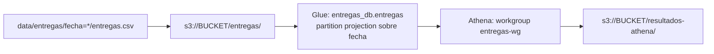

# Examen final: Evelyn Gomez

- intentos de entrega en S3, Glue y Athena con partition projection

Los CSV diarios de intentos de entrega quedan en Amazon S3. Una tabla externa en Glue Data Catalog describe su esquema y define partition projection sobre `fecha`, así Athena calcula durante la consulta qué prefijos leer y una fecha nueva se consulta apenas se sube su archivo. No se usan crawlers, `MSCK REPAIR TABLE` ni `ALTER TABLE ADD PARTITION`.



## Estructura

```text
infraestructura/   Terraform (principal.tf, variables.tf, salidas.tf)
consultas/         SQL de la demostración inicial y de la verificación del tercer día
resultados/        Resultados obtenidos en Athena, separados en inicial/ y final/
evidencias/        Salidas de Terraform, outputs, registro de ejecuciones de Athena y eliminación
scripts/           Ejecución de consultas en Athena y comparación con las referencias
data/              CSV suministrados (sin modificar)
resultados_esperados/  Referencias suministradas (no se suben a S3)
respuestas.md      Respuestas a las preguntas conceptuales
```

## Prerrequisitos

- Terraform 1.5 o superior.
- AWS CLI v2 con credenciales que permitan administrar S3, Glue Data Catalog y Athena. Las credenciales viven en `~/.aws/` o en variables de entorno y nunca dentro del repositorio.
- Región `us-east-1` (configurable con la variable `region`).
- Bash. Los scripts funcionan con el Bash 3.2 de macOS y en Linux.

Comprobar la identidad antes de empezar. `AWS_PAGER=""` evita que la CLI abra el paginador.

```bash
export AWS_PAGER=""
aws sts get-caller-identity
```

## Configuración

Todas las variables tienen valor por defecto en `infraestructura/variables.tf`.

| Variable | Valor por defecto | Uso |
| --- | --- | --- |
| `region` | `us-east-1` | Región de todos los recursos |
| `nombre_bucket` | `de-final-entregas-evyg06` | Bucket privado, debe ser único en S3 |
| `prefijo_datos` | `entregas/` | Prefijo de los CSV |
| `prefijo_resultados` | `resultados-athena/` | Prefijo de resultados de Athena |
| `nombre_base_datos` | `entregas_db` | Base de datos de Glue |
| `nombre_tabla` | `entregas` | Tabla externa |
| `nombre_workgroup` | `entregas-wg` | Workgroup de Athena |
| `fecha_inicio_proyeccion` | `2026-10-01` | Inicio del rango proyectado, incluido |
| `fecha_fin_proyeccion` | `2026-10-03` | Fin del rango proyectado, incluido |

Si el nombre del bucket ya existe en S3, se cambia al aplicar con `-var 'nombre_bucket=otro-nombre'`. Las consultas SQL usan `entregas_db.entregas`. Si se cambian esos nombres hay que ajustar el SQL.

### Recursos definidos

- `aws_s3_bucket.datos` y `aws_s3_bucket_public_access_block.datos`. Bucket privado con las cuatro opciones de bloqueo de acceso público activas. Los prefijos `entregas/` y `resultados-athena/` son parte de las claves de los objetos y se definen como variables que usan la tabla y el workgroup.
- `aws_glue_catalog_database.entregas`.
- `aws_glue_catalog_table.entregas`. Tabla `EXTERNAL_TABLE` con `LazySimpleSerDe`, separador coma y `skip.header.line.count = 1`. Tiene las cinco columnas del archivo en su orden (`id_envio string`, `ciudad string`, `transportadora string`, `estado string`, `duracion_minutos int`) y `fecha string` como clave de partición. Partition projection queda así.

  | Propiedad | Valor |
  | --- | --- |
  | `projection.enabled` | `true` |
  | `projection.fecha.type` | `date` |
  | `projection.fecha.format` | `yyyy-MM-dd` |
  | `projection.fecha.range` | `2026-10-01,2026-10-03` |
  | `projection.fecha.interval` | `1` |
  | `projection.fecha.interval.unit` | `DAYS` |
  | `storage.location.template` | `s3://BUCKET/entregas/fecha=${fecha}/` |

- `aws_athena_workgroup.entregas`. Los resultados van a `s3://BUCKET/resultados-athena/` con cifrado SSE-S3, y `enforce_workgroup_configuration` impide que una consulta los envíe a otro lugar.

No se crean particiones individuales en Terraform.

## 1. Despliegue

```bash
cd infraestructura
terraform init
terraform fmt -check
terraform validate
terraform apply -auto-approve -no-color 2>&1 | tee ../evidencias/aplicacion_terraform.txt
terraform output -json > ../evidencias/outputs.json
cd ..
```

`evidencias/aplicacion_terraform.txt` contiene el plan y el resultado del apply. `evidencias/outputs.json` identifica el bucket, la base de datos, la tabla y el workgroup.

## 2. Carga inicial: días 1 y 2

Se suben solo dos archivos, uno por uno, a su prefijo exacto. El día 3 queda local.

```bash
BUCKET=$(terraform -chdir=infraestructura output -raw bucket)
aws s3 cp "data/entregas/fecha=2026-10-01/entregas.csv" "s3://$BUCKET/entregas/fecha=2026-10-01/entregas.csv"
aws s3 cp "data/entregas/fecha=2026-10-02/entregas.csv" "s3://$BUCKET/entregas/fecha=2026-10-02/entregas.csv"
aws s3 ls "s3://$BUCKET/entregas/" --recursive | tee evidencias/objetos_s3_inicial.txt
```

## 3. Consultas iniciales

`scripts/ejecutar_athena.sh` lanza la sentencia en el workgroup del ejercicio y espera a que termine. Después descarga el CSV de resultados desde `resultados-athena/` y agrega la fila `etapa,archivo_sql,id_ejecucion,archivo_resultado` a `evidencias/ejecuciones_athena.csv`. Athena entrega cada valor entre comillas dobles. Como los datos no contienen comas ni comillas, el script las retira para que el archivo quede en el mismo formato de `resultados_esperados/`. El CSV original queda en S3 bajo el identificador de ejecución.

```bash
bash scripts/ejecutar_athena.sh inicial consultas/intentos_por_fecha_estado.sql resultados/inicial/intentos_por_fecha_estado.csv
bash scripts/ejecutar_athena.sh inicial consultas/porcentaje_exito_por_fecha_ciudad.sql resultados/inicial/porcentaje_exito_por_fecha_ciudad.csv
bash scripts/ejecutar_athena.sh inicial consultas/duracion_promedio_2026-10-02.sql resultados/inicial/duracion_promedio_2026-10-02.csv
bash scripts/ejecutar_athena.sh inicial consultas/verificacion_tercer_dia.sql resultados/inicial/registros_por_fecha.csv 3
bash scripts/comparar_resultados.sh inicial
```

La última ejecución reutiliza la sentencia 3 de `verificacion_tercer_dia.sql` y muestra que en esta etapa hay 12 registros (6 por día). `comparar_resultados.sh` hace un `diff` contra cada referencia y responde `OK` cuando son idénticos.

Detalles de las consultas.

- El porcentaje se calcula como `100 * exitosos / total` con el numerador en `DOUBLE`, así no hay división entera. El denominador es `COUNT(*)` e incluye los tres estados. El resultado se redondea y se presenta como `DECIMAL(5,2)`.
- El promedio filtra `estado = 'entregado'` antes de agregar, así los ceros de los intentos fallidos no entran. También filtra `fecha = '2026-10-02'`, de modo que Athena lee solo esa partición.
- Las consultas de intentos y porcentaje no filtran por fecha y cubren todo el rango proyectado. Las fechas sin archivo no aportan filas.

## 4. Nueva fecha: día 3

No se cambia la infraestructura ni la tabla. Solo se sube el archivo y se consulta.

```bash
aws s3 cp "data/entregas/fecha=2026-10-03/entregas.csv" "s3://$BUCKET/entregas/fecha=2026-10-03/entregas.csv"
aws s3 ls "s3://$BUCKET/entregas/" --recursive | tee evidencias/objetos_s3_final.txt

bash scripts/ejecutar_athena.sh final consultas/verificacion_tercer_dia.sql resultados/final/verificacion_tercer_dia.csv 1
bash scripts/ejecutar_athena.sh final consultas/verificacion_tercer_dia.sql resultados/final/conteo_estados_tercer_dia.csv 2
bash scripts/ejecutar_athena.sh final consultas/verificacion_tercer_dia.sql resultados/final/registros_por_fecha.csv 3
bash scripts/ejecutar_athena.sh final consultas/intentos_por_fecha_estado.sql resultados/final/intentos_por_fecha_estado.csv
bash scripts/ejecutar_athena.sh final consultas/porcentaje_exito_por_fecha_ciudad.sql resultados/final/porcentaje_exito_por_fecha_ciudad.csv
bash scripts/comparar_resultados.sh final
```

| Archivo | Muestra |
| --- | --- |
| `resultados/final/verificacion_tercer_dia.csv` | Los 6 registros de `2026-10-03` |
| `resultados/final/conteo_estados_tercer_dia.csv` | 3 `destinatario_ausente`, 1 `direccion_incorrecta` y 2 `entregado` el día 3 |
| `resultados/final/registros_por_fecha.csv` | 6 registros por fecha y 18 en total |
| `resultados/final/intentos_por_fecha_estado.csv` | 9 filas, igual a la referencia final |
| `resultados/final/porcentaje_exito_por_fecha_ciudad.csv` | 6 filas, igual a la referencia final |

Evidencia de que no se registraron particiones ni se cambió la tabla.

```bash
aws glue get-partitions --region "$(terraform -chdir=infraestructura output -raw region)" \
    --database-name entregas_db --table-name entregas > evidencias/particiones_glue.json
terraform -chdir=infraestructura plan -no-color -detailed-exitcode > evidencias/plan_sin_cambios.txt; echo "codigo de salida del plan: $?"
```

`particiones_glue.json` debe mostrar `"Partitions": []`. El código de salida `0` de `plan -detailed-exitcode` quiere decir que la infraestructura coincide con el código y no hay cambios pendientes.

## 5. Limpieza

Antes de eliminar se guardan todas las evidencias anteriores. El bucket tiene `force_destroy = true` y el workgroup también, así que `terraform destroy` borra los CSV y los resultados de Athena junto con los recursos.

```bash
terraform -chdir=infraestructura destroy -auto-approve -no-color 2>&1 | tee evidencias/eliminacion_terraform.txt
```

Para vaciar el bucket por separado antes del destroy se puede usar `aws s3 rm "s3://$BUCKET" --recursive`.

## Seguridad

- El bucket bloquea todo acceso público y los resultados de Athena se cifran con SSE-S3.
- `.gitignore` excluye `.terraform/`, `*.tfstate*`, `*.tfvars`, archivos de credenciales y `.env`. `.terraform.lock.hcl` sí se versiona para fijar la versión del proveedor.
